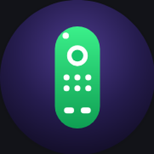

<div align="center">



# Controlix

**An Android IR remote that gets out of the way — no account, no ads, no location, no network.**

Offline-first · Farsi/English with real RTL · Tasker automation · 66 unit tests

[](https://github.com/ErfanBagheri404/Controlix/actions/workflows/ci.yml)
[](https://github.com/ErfanBagheri404/Controlix/releases/latest)
[](LICENSE)

</div>

---

Most remote apps want your account, your location, and your data. Controlix wants
your TV to turn on. Point the phone, press the button, the device responds —
nothing else happens.

- **No account.** Ever. Not for setup, not for "pro", not for syncing.
- **No ads, no analytics, no location.** The manifest asks for `TRANSMIT_IR` and
  nothing the app doesn't use.
- **Offline after install.** Works on a plane. The DB refresh is opt-in and is the
  only reason the app ever opens a socket.
- **No Mi Remote codes.** Every code is community-contributed and
  permissively licensed (see [Code database](#code-database)).

## Requirements

- **Android 8.0 (API 26) or newer**
- **A phone with an IR blaster.** Xiaomi/Redmi/Poco, Huawei/Honor, vivo, older
  Samsung/HTC and others. Check first: **Tools → IR self-test** flashes your
  emitter, viewable through a camera.

No IR blaster? Every screen stays open for browsing, sharing and automation, but
nothing transmits.

## Install

Grab a per-ABI APK from [Releases](https://github.com/ErfanBagheri404/Controlix/releases/latest)
(`arm64-v8a` for virtually every modern phone), or build it yourself:

```bash
git clone https://github.com/ErfanBagheri404/Controlix
cd Controlix
./gradlew assembleDebug        # debug APK
./gradlew testDebugUnitTest    # 66 unit tests
```

Needs JDK 17+ and an Android SDK with platform 35. `local.properties` must point at your SDK:

```properties
sdk.dir=/path/to/Android/Sdk
```

## Features

### Remote

- **Category → brand → remote** picker across TVs, ACs, set-top boxes, projectors,
  soundbars, receivers, streaming boxes, fans, consoles, air purifiers and more.
- **Exact-model search.** Type `UN55D6000`; get the remote whose header lists that model.
- **Layouts that fit the device.** AC remotes get temperature/mode/fan pickers;
  D-pad, transport, numeric keypad and volume/channel rails per device class.
- **Free layout.** Reorder, re-grid, or blank out any pad key.
- **Hardware volume keys work.** VOL± on the phone drives the on-screen remote,
  with the same hold-to-repeat cadence as the rocker.
- **Missing codes are found, not forgotten.** If a key has no code, Controlix says
  which one, on which remote, and queues a prefilled report.

### Automation

- **Quick-settings tile** — your most-used remote, one swipe from anywhere.
- **Tasker / MacroDroid / `adb`** via a broadcast, off by default and token-guarded:

```bash
adb shell am broadcast -a com.erfanbagheri.controlix.TRANSMIT \
    --es remote_name "Living Room TV" --es button power --ei repeat 2
adb shell am broadcast -a com.erfanbagheri.controlix.TRANSMIT \
    --ei carrier_hz 38000 --es pattern "9000,4500,560,1690,560,1690"
```

Without a token, any app on the phone can fire your codes. Set one in
**Menu → Automation → Set a broadcast token**; every broadcast then needs
`--es token <value>`.

- **Cross-device macros & scenes** — "movie time" = TV on, receiver to HDMI 2,
  AC to 24 °C, each with its own delay.
- **Widget & scene favourites.**

### Sharing & data

- **QR / URI remote sharing** — a configured remote becomes a scannable code.
- **Backup & restore** (JSON round-trip, unit-tested).
- **Community-updatable code database** — contribute codes by pull request,
  the same model that made irdb work.
- **Full Farsi localization** with real RTL: mirrored layout, localized digits,
  Yekan Bakh typeface, pad keys pinned LTR so arrow/VOL/CH rows stay readable.

### Tools

- **IR self-test** — proves your emitter fires.
- **Signal analyzer** — decode what your old remote sends, byte by byte.
- **TV-B-Gone** — the classic power-off sweep.
- **Database health** — see exactly what's bundled and what's missing.

## Non-goals

These are permanent decisions, not backlog items.

- **iOS.** No iPhone has ever shipped an IR blaster. A Wi-Fi-only companion app
  would have no reason to exist.
- **"Learning mode."** Android's `ConsumerIrManager` is transmit-only on every
  consumer phone — the hardware physically cannot receive or decode an incoming
  IR signal. "Aim your old remote at the phone" is not implementable. Codes come
  from databases plus manual raw-timing entry. (The signal analyzer works by
  reading a *logged* capture, not by receiving live.)
- **Accounts, telemetry, ads, location, content feeds.**

## Code database

Codes come from crowd-sourced, permissively licensed databases, merged by scripts in
[`src/main/python/`](src/main/python):

- [Flipper-IRDB](https://github.com/logickworkshop/Flipper-IRDB) — ~50 device
  categories, 118 TV brands alone, `.ir` files in parsed or raw form.
- [irdb](https://github.com/probonopd/irdb) — protocol/device/function notation,
  3205 manufacturers.
- [lirc-remotes](https://github.com/probonopd/lirc-remotes) — the classic LIRC
  community database (2646 remotes).

Contains data from irdb and lirc-remotes by Simon Peter and contributors, used
under permission. For licensing details and for information on how to contribute to
the database, see <https://github.com/probonopd/irdb>.

The bundled database ships in the APK; see [docs/DB.md](docs/DB.md) for the
pipeline and provenance rules.

## Architecture

```
app/src/main/java/com/erfanbagheri/controlix/
├── MainActivity.kt          Compose entry point; l10n, hardware volume keys
├── ir/                      IR hardware + parsing + protocol encoders
│   ├── IrTransmitter.kt     ConsumerIrManager wrapper — the only hardware surface
│   ├── ProntoParser.kt      Pronto Hex → carrier + microsecond pattern
│   ├── IrFileImporter.kt    .ir / LIRC / Pronto-NX ingestion
│   ├── protocols/           NEC, Samsung32, RC5/RC6, SIRC, Kaseikyo…
│   └── SignalInspector.kt   decoder for analyzer + test bursts
├── data/                    SQLite DB, device store, effective-button resolver
├── feature/                 macros, scenes, favourites, automation receiver
├── ui/                      Compose screens + icons
├── widget/                  home-screen widget
└── quicksettings/           quick-settings tile
```

**114 Kotlin files, 66 unit tests.** The app's entire hardware dependency is
`ConsumerIrManager.transmit(carrierHz, pattern)`. Everything else is data and UI.

Borrowed codes are first-class: when a remote lacks a key, the resolver borrows the
best-matching sibling code from the brand, marks it in the UI, and remembers what
you accepted so it gets better on every session.

## Contributing

Pull requests are welcome, especially **code contributions** for devices the
database doesn't cover — the "Missing a code?" flow inside the app builds a
validated submission bundle for you.

```bash
./gradlew testDebugUnitTest    # run the suite before you push
```

By contributing you agree your code/data is licensed under GPL-3.0.

## License

[GNU General Public License v3.0](LICENSE). See [LICENSE](LICENSE) for the full text.

© Controlix contributors. IR code data © their respective authors, used under permission
(see [Code database](#code-database)).